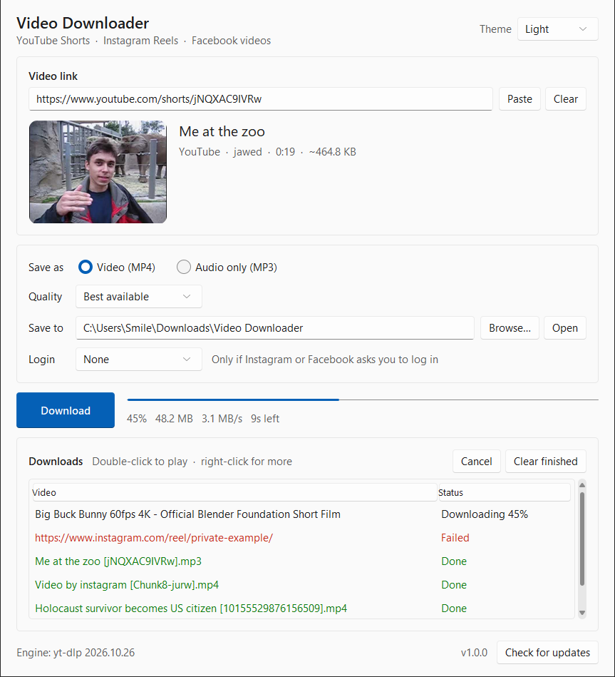
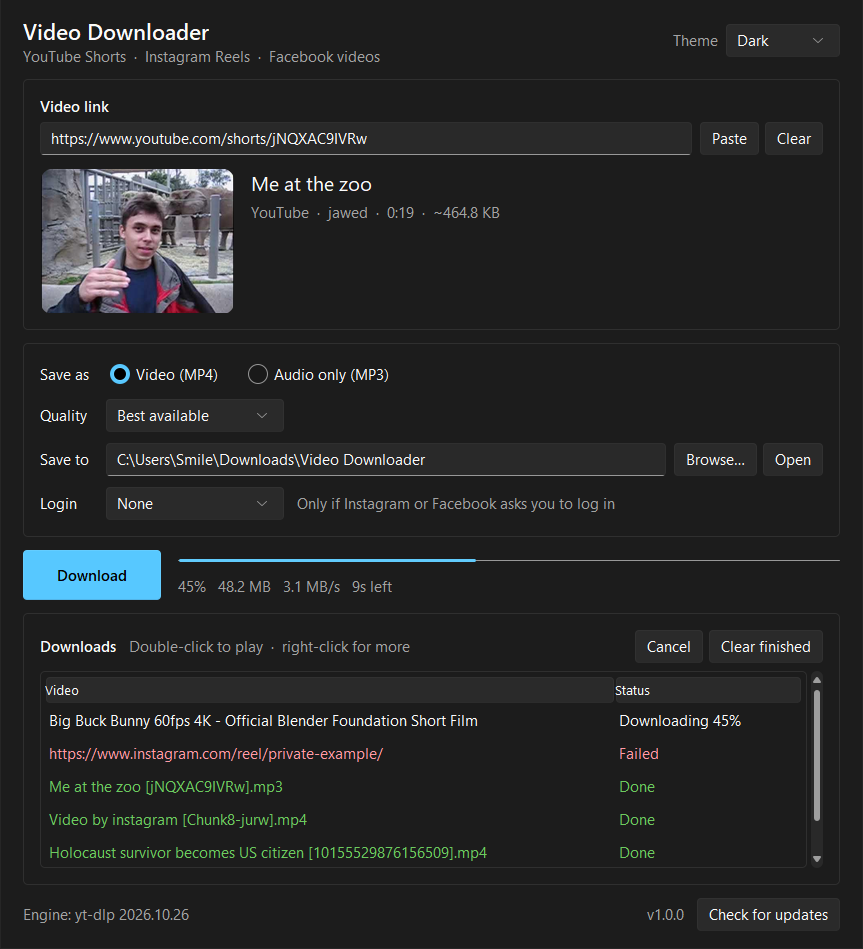

# Video Downloader

A small Windows app that saves YouTube Shorts, Instagram Reels and Facebook videos as
MP4 video or MP3 audio. It also works with most other sites that
[yt-dlp](https://github.com/yt-dlp/yt-dlp) supports.




## Download

Get `VideoDownloader-<version>-win64.zip` from the
[latest release](https://github.com/Sivasubburaj/video-downloader/releases/latest), unzip
it and run `Video Downloader.exe`. Nothing is installed. Requires Windows 10 or 11 (64-bit).

The app isn't code-signed, so Windows SmartScreen may say "Windows protected your PC" the
first time. Click *More info* → *Run anyway*.

The user guide that ships in the zip is [app/README.txt](app/README.txt).

## Features

- Paste a link to see the title, thumbnail, channel and length before downloading
- MP4 video (Best, 1080p, 720p, 480p or 360p) or MP3 audio
- Download queue with progress, cancel, and double-click to play
- Login option for Instagram and Facebook posts that need it: Firefox, Chrome, Edge, Brave
  or Opera, or a cookies.txt file
- Windows 11-style interface with Light, Dark and System themes and a matching title bar
- The download engine (yt-dlp) updates itself every few days, or with "Check for updates"
- `"Video Downloader.exe" [--download] <link>` opens the app with a link ready, or starts
  downloading it straight away

## Build from source

You need Windows, Python 3.14 and [uv](https://docs.astral.sh/uv/). From the repo folder:

```bash
uv run --no-project --python 3.14 --with pyinstaller --with pillow --with imageio-ffmpeg --with sv-ttk app/build.py
```

The build:

1. downloads the latest `yt-dlp.exe` and checks it against the release's SHA-256 sums,
2. bundles FFmpeg from [imageio-ffmpeg](https://github.com/imageio/imageio-ffmpeg),
3. draws the icon and builds `dist/Video Downloader/` with PyInstaller,
4. writes `release/VideoDownloader-<version>-win64.zip` and `SHA256SUMS.txt`.

The version number is `APP_VERSION` in [app/downloader.py](app/downloader.py).

After one build (it leaves yt-dlp and FFmpeg in `app/bin`), you can run the app straight
from source:

```bash
uv run --no-project --python 3.14 --with pillow --with sv-ttk app/downloader.py
```

## Project layout

| Path | What it is |
| --- | --- |
| [app/downloader.py](app/downloader.py) | The app (tkinter with the Sun Valley theme) |
| [app/build.py](app/build.py) | Builds the release zip |
| [app/README.txt](app/README.txt) | User guide, shipped in the zip |
| [app/THIRD-PARTY-NOTICES.txt](app/THIRD-PARTY-NOTICES.txt) | License notices, filled in with tool versions by the build |
| [app/RELEASE-NOTES.md](app/RELEASE-NOTES.md) | Notes for the current release |
| [screenshots/](screenshots) | Screenshots used here and in the release notes |

## License

The app's source code is under the [MIT License](LICENSE). The release zip also contains
yt-dlp (Unlicense), FFmpeg (GPLv3) and other components under their own licenses; see
[app/THIRD-PARTY-NOTICES.txt](app/THIRD-PARTY-NOTICES.txt).

Only download videos you own, have permission to use, or that are licensed for reuse.
YouTube, Instagram and Facebook are trademarks of their owners. This project is not
affiliated with or endorsed by them.
